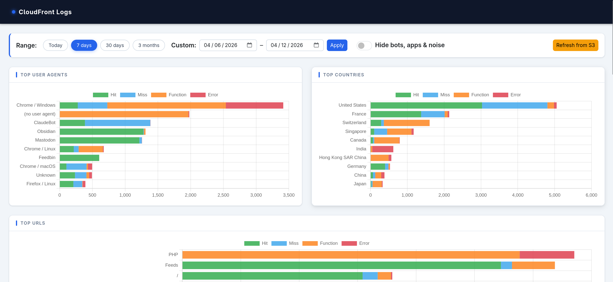

 [](https://sonarcloud.io/summary/new_code?id=christ-off_analyze-logs)

# analyze-logs

Spring Boot web dashboard for [Amazon CloudFront standard logs](https://docs.aws.amazon.com/AmazonCloudFront/latest/DeveloperGuide/AccessLogs.html) (w3c tab-separated or JSON format).
Fetches log files from S3, stores them in a local SQLite database, and displays interactive charts with drill-down detail pages.



## Security notice

**This application is intended for local, single-user use only.**

- There is **no authentication or authorization**. Anyone who can reach port 8080 can view the dashboard and trigger S3 fetches.
- **CSRF protection is enabled** (Spring Security defaults). The one state-changing operation, `Refresh from S3`, is a POST whose token Thymeleaf injects via `th:action`. The application should still not be exposed to untrusted networks, since anyone who can reach it can load the form and submit it.

**Do not expose this application on a public interface or behind a shared reverse proxy without adding authentication (e.g. Spring Security with HTTP Basic, or an authenticating proxy such as nginx/Authelia).**

### Security controls in place

A security review found no exploitable vulnerabilities. The following controls are verified:

| Area | Control |
|------|---------|
| SQL injection | All database queries use `JdbcTemplate` with `?` bind parameters. User-supplied values are never interpolated into SQL strings. |
| XSS (server-side) | All Thymeleaf templates use `th:text` / `th:content` for user-controlled output, which applies automatic HTML entity escaping. `th:utext` is not used anywhere. |
| XSS (client-side) | API responses are rendered onto `<canvas>` via Chart.js. Canvas drawing APIs do not interpret HTML or JavaScript. `encodeURIComponent()` is applied to all user-derived values placed into URLs. |
| Path traversal | No file-serving endpoints with user-controlled paths exist. S3 object keys come from AWS API responses, not from user input. |
| CSRF | Spring Security's CSRF filter is enabled with session-backed tokens, and the token is resolved before the view renders (deferred loading is disabled). The only state-changing endpoint, `POST /refresh`, is therefore token-protected. |
| Data exposure | API endpoints return only CloudFront access-log data, which is the application's stated purpose. No credentials or internal state are exposed. |

## Build & run

Requires Java 25 (`java.version` in `pom.xml`) and Maven.

```bash
mvn package
java -jar target/analyze-logs-1.0-SNAPSHOT.jar --spring.profiles.active=local
```

Or without packaging:

```bash
mvn spring-boot:run -Dspring-boot.run.profiles=local
```

Open `http://localhost:8080`.

### Tests

`mvn verify` runs fully offline. `RobotsServiceTest` serves `robots.txt` from
`src/test/resources/robots-snapshot.txt` instead of fetching the live site, so CI never depends on
the blog being up, reachable or un-blocked. Refresh the snapshot now and then:

```bash
curl -o src/test/resources/robots-snapshot.txt https://post-tenebras-lire.net/robots.txt
```

Keep provenance in a comment at the top if you want it — comment lines are ignored by the parser:
`# Snapshot: 2026-11-18, fetched from post-tenebras-lire.net/robots.txt`.

The tests assert structure (rules stored, stale rows cleared, `refreshed_at` set, the configured
`app.robots-url` requested) rather than this exact content, so a stale snapshot never fails the
build — it just stops proving `parseRules()` against production. This snapshot yields **82 rules
across 37 user agents**. If a future refresh writes a very different number, check that the live
file still separates its groups with blank lines: the parser splits blocks on blank lines, so a
missing one merges two groups and every agent in them inherits every `Disallow`.

## Configuration

### `application.yml` (committed — safe defaults)

Key properties:

| Key | Default | Description |
|-----|---------|-------------|
| `app.aws.region` | `eu-west-3` | AWS region of the S3 bucket |
| `app.aws.bucket` | `` | S3 bucket containing CloudFront logs |
| `app.aws.prefix` | `` | S3 key prefix (e.g. `AWSLogs/123456789/CloudFront/`) |
| `app.aws.profile` | `` | AWS credentials profile (`~/.aws/credentials`); empty = default chain |
| `app.db-path` | `logs.db` | SQLite file path (relative to working directory) |
| `server.port` | `8080` | HTTP port |
| `uri-stem-filter.excluded-extensions` | `.css`, `.js`, `.png`, … | File extensions excluded from all URL charts (static assets) |
| `referer-filter.self-referers` | `[]` | Referer prefixes to exclude from Top Referers (your own domain). Matched with and without trailing slash, and as a bare domain without scheme. |
| `app.top-limit`, `app.top-detail-limit`, `app.top-urls-limit`, `app.top-referers-limit` | `10`, `20`, `20`, `20` | Number of rows in the "Top …" charts |
| `app.nb-months-to-keep` | `3` | Months of logs kept in the database |
| `app.robots-url` | the blog's `/robots.txt` | `robots.txt` fetched by **Refresh Robots** |
| `app.firefox-esr-version` | `115` | Firefox ESR major version used by the browser pages |
| `uri-stem-groups.groups` | PHP/WordPress, Env/credential file probing, Config/backup dump probing, Open-proxy / IP-echo probing, Java/Spring exploit probing, CGI-bin / router-IoT probing | Groups of `uri_stem` LIKE patterns collapsed into one label on the **Top URLs** chart. A group with `security: true` also feeds the **Security** traffic category and the [Security page](#security-page). |

### `application-local.yml` (gitignored — your secrets)

Create `src/main/resources/application-local.yml` to override values without touching the committed file:

```yaml
referer-filter:
  self-referers:
    - "https://your-site.example.com/"
    - "http://your-site.example.com/"

app:
  aws:
    bucket: "my-cloudfront-logs"
    prefix: "AWSLogs/123456789/CloudFront/"
    profile: "my-aws-profile"
  db-path: /absolute/path/to/logs.db
```

This file is listed in `.gitignore` and will never be committed. Activate it with `--spring.profiles.active=local`.

### User-agent and referer rules

UA classification and referer grouping are stored in the database (`static_ua`, `static_referer`
tables, seeded by Liquibase changesets), not in `application.yml`. Edit them on the
**Admin** page (`/admin`): add, update or delete a UA pattern or a referer rule, then **Reclassify**
to apply the rules to the existing rows.

## Dashboard

### Bot Analysis page

Sections, all scoped to the selected date range:

| Section | Detection signal |
|---------|-----------------|
| **Countries with Most Filtered Traffic** | Countries ranked by requests answered by the CloudFront function (Filtered). |
| **Most Active Bots** | Known bots ranked by request count. |
| **Top Probable Bots** | IPs that fetched `/robots.txt` and then crawled another URL within 1 hour using the same IP and user agent. |
| **Site Config Fetchers** | Browsers that requested `robots.txt`, `ads.txt`, `sitemap.xml`, `humans.txt`, `llms.txt`, `ai.txt` or `security.txt` — real browsers never do. |
| **Bots Skipping Robots.txt** | Known bots active in the range that have never requested `/robots.txt` (checked across the full log). |
| **Robots.txt Disobedient Bots** | Known bots that requested a path their `robots.txt` group disallows (a bot with no named group falls back to `User-agent: *`; `/robots.txt` itself is always allowed). Requires a **Refresh Robots** to load the latest rules. |
| **Robots.txt Obedient Bots** | Known bots that fetched `/robots.txt` and never requested a path disallowed for them; the count is their other content requests (excluding `/robots.txt`); the bar covers all their requests. |

The **Bot vs Human Traffic Over Time** chart shows daily request volume split between known bots (AI Bots, Search Bots, Other Bots, Apps) and human browsers.

Date range presets and custom date picker are shared with the main dashboard.

### Social Referrals page

Three stacked sections — Mastodon, WhatsApp, Facebook — each listing the most recent webpage requests
(URIs ending in `/`; static assets excluded) matching that network's known link-preview crawler user
agent (`facebookexternalhit`, `WhatsApp`) or a click-through `Referer` from its domain. Referer domains
are host-anchored (scheme + optional `www.` + exact domain) so `facebook.com` never matches a look-alike
host such as `facebook.com.evil.example`. Mastodon is matched on the user-agent classifier's `ua_name`
instead (fediverse UA strings vary too much for substring matching) and excludes the home page `/`,
which every instance polls often enough to bury the actual article previews. Only served pages count — Hit, RefreshHit
and Miss; Filtered and Error responses are dropped. Each row shows its timestamp, a link to the user
agent's `/ua-requests` page (rows are raw user agents, so they key on the raw string), the URI and the
country.

### Main dashboard

Seven charts, all scoped to the selected date range:

| Chart | Description |
|-------|-------------|
| Top User Agents | Horizontal stacked bar — classified UA names by request count, coloured by edge result type. Click a bar to open the UA detail page. |
| Top Countries | Horizontal stacked bar — request volume by country, coloured by edge result type. Click a bar to open the country detail page. |
| Top URLs | Horizontal stacked bar — most-requested paths, coloured by edge result type; static assets excluded, and `uri-stem-groups` patterns (PHP/WordPress, `.env`/`.git` probing, backup dumps, actuator/Struts, cgi-bin, etc.) collapsed into one label each. |
| Top Referers | Horizontal bar — most frequent `Referer` headers; self-referrals and null referers excluded. Known search engines and social sites are grouped under a single label (rules edited on the **Admin** page). Click a bar to open the referer detail page. |
| User Agent Groups | Pie — request share by UA group (Browsers, AI Bots, Search Bots, Other Bots, Apps, Feed Readers). |
| Platforms | Pie — request share by OS/platform detected from the user agent (iOS, Android, Windows, Mac, Linux, Other). |
| Requests per Day | Stacked bar — daily breakdown by edge result type: Hit, Miss, Function, Redirect, Error. |

Date range presets: **Today / 7 days / 30 days / 3 months** or a custom date picker.

**Refresh from S3** button triggers an incremental fetch (skips already-imported files).

### Countries page

One sortable table of all countries for the selected date range: requests, human requests, Mastodon requests (excluding `/`, which Mastodon polls without human interaction), search-bot requests, % human (same "Probable human" classification as the country detail page) and a Hit / Miss / Filtered / Error bar. Use it to spot countries with many requests but almost no human traffic — candidates for blocking upstream.

### Security page

Focuses on the traffic flagged by `uri-stem-groups` entries with `security: true` (scanner/exploit probing), scoped to the selected date range:

| Chart | Description |
|-------|-------------|
| Traffic Categories | Horizontal bar — request count per security scan category (PHP/WordPress, Env/credential file probing, Config/backup dump probing, Open-proxy / IP-echo probing, Java/Spring exploit probing, CGI-bin / router-IoT probing). |
| Top Countries | Horizontal bar — countries the security-flagged requests originate from. |
| Requests per Day | Stacked bar — daily breakdown by scan category. |

Date range presets are shared with the main dashboard.

### UA detail page

Opened by clicking a bar in **Top User Agents**. Shows charts scoped to a single classified user-agent:

| Chart | Description |
|-------|-------------|
| Result Types | Pie — edge result type breakdown for this UA |
| Countries | Pie — geographic distribution of requests |
| Top URLs | Horizontal stacked bar — most-requested paths for this UA, coloured by edge result type (PHP / WordPress grouping applied) |
| Requests per Day | Line — daily request trend by edge result type |

### Country detail page

Opened by clicking a bar in **Top Countries** or a row of the **Countries** page. Shows charts scoped to a single country:

| Chart | Description |
|-------|-------------|
| Result Types | Pie — edge result type breakdown for this country |
| Top URLs | Horizontal stacked bar — most-requested paths from this country, coloured by edge result type (PHP / WordPress grouping applied) |
| Requests per Day | Line — daily request trend by edge result type |

### Human page

Traffic from "probable human" visitors only (distinct IP + user agent): the same top charts and requests per day as the main dashboard, plus a table of requests from unknown
user agents (each linking to its `/ua-requests` page). See [Known limitations](#known-limitations) for how a visitor qualifies as human.

### ASN page

Per-ASN table (name, category, % human, requests) for logs delivered with the `asn` field (since 2026-11-11), with a category filter. Names and categories come from the `asn_info` table; load them once with the **Names** download button on the page. Click an ASN to open its detail page.

### Blocked Hosted Applications page

`/blocked-hosted-apps`: two lists scoped to the selected date range, restricted to requests whose
ASN is classified `hosting` or `business` in `asn_info` (so the ASN names must be downloaded once on
the ASN page, and only logs since 2026-11-11 carry the ASN field). These are apps blocked by the
CloudFront function while running on rented infrastructure — candidates to review for the allowlist.
Each row shows the raw user agent (link to its UA requests page — keyed by the raw string, unlike the
UA detail page which is keyed by the classified `ua_name`) and its blocked-request count.

| List | Content |
|------|---------|
| **Blocked Feed Readers** | User agents that requested *nothing but* `/feed.xml` / `/rss.xml` in the range and were Filtered — a UA that also fetched content paths is a scraper, not a reader, and is dropped. |
| **Blocked Fediverse** | User agents that requested *nothing but* the home page (`/`) in the range and were Filtered — link-preview bots; a UA that also fetched content paths (following links like a visitor) is dropped. |

Later, add a third list, **Other blocked apps**. Its criteria are not known yet — decide which
requests and which ASN categories define it before implementing.

### Browsers pages

`/chrome`, `/firefox`, `/edge` and `/safari`: request count and share of human traffic per browser version, plus the usual detail charts.

### Other pages

| Page | Content |
|------|---------|
| Covers (`/covers`) | User agents and referers fetching post cover images. |
| URL detail, Referer detail, IP requests, UA requests | Drill-down pages opened from the charts above. |
| Admin (`/admin`) | Edit UA and referer rules, reclassify existing rows. |

## AWS credentials

No credentials are stored by this application. Authentication is delegated to the
[AWS SDK default credentials chain](https://docs.aws.amazon.com/sdk-for-java/latest/developer-guide/credentials-chain.html):

1. Environment variables — `AWS_ACCESS_KEY_ID` / `AWS_SECRET_ACCESS_KEY`
2. `~/.aws/credentials` — populated by `aws configure`
3. EC2/ECS instance profile

### Minimum required IAM permissions

```json
{
  "Effect": "Allow",
  "Action": ["s3:ListBucket", "s3:GetObject"],
  "Resource": [
    "arn:aws:s3:::my-cloudfront-logs",
    "arn:aws:s3:::my-cloudfront-logs/*"
  ]
}
```

## Known limitations

### "Probable human" traffic can include bots

A `(client_ip, user_agent)` pair counts as **Probable human** if it ever requests a trailing-slash
path (e.g. `/`) *and* any icon svg (`/assets/svgs/*.svg`), each as a Hit or Miss. The stylesheet is
deliberately not required: browsers serve it from cache on return visits, while scrapers do fetch it.
The Human page applies the same rule, but requires the svg within ±1h of the page request. A bot that
fetches an svg can still qualify. Known limitation, not currently fixed.

---

## Database

Logs are stored in a SQLite file (`logs.db` by default, relative to the working directory).
Query it directly with any SQLite-compatible tool:

```bash
sqlite3 logs.db "SELECT ua_name, COUNT(*) FROM cloudfront_logs GROUP BY ua_name ORDER BY 2 DESC"
```

### Schema

```sql
cloudfront_logs (
    id                        INTEGER PRIMARY KEY,
    timestamp                 TEXT NOT NULL,   -- ISO-8601 UTC
    edge_location             TEXT,
    client_ip                 TEXT,
    method                    TEXT,
    uri_stem                  TEXT,
    status                    INTEGER,
    referer                   TEXT,
    user_agent                TEXT,
    edge_result_type          TEXT,
    edge_response_result_type TEXT,
    edge_detailed_result_type TEXT,
    content_type              TEXT,
    country                   TEXT,            -- ISO 3166-1 alpha-2
    ua_name                   TEXT,            -- classified user-agent label
    edge_location_iata        TEXT,            -- IATA code from edge_location
    asn                       TEXT             -- empty for logs before 2026-11-11 22:00 UTC
)

fetched_files (
    s3_key     TEXT PRIMARY KEY,
    fetched_at TEXT
)

asn_info (
    asn          TEXT PRIMARY KEY,
    handle       TEXT,
    name         TEXT,
    country_code TEXT,
    category     TEXT
)
```

Also: `static_ua` and `static_referer` (classification rules, see [User-agent and referer rules](#user-agent-and-referer-rules)) and `robots_rules` (parsed `robots.txt` groups).
